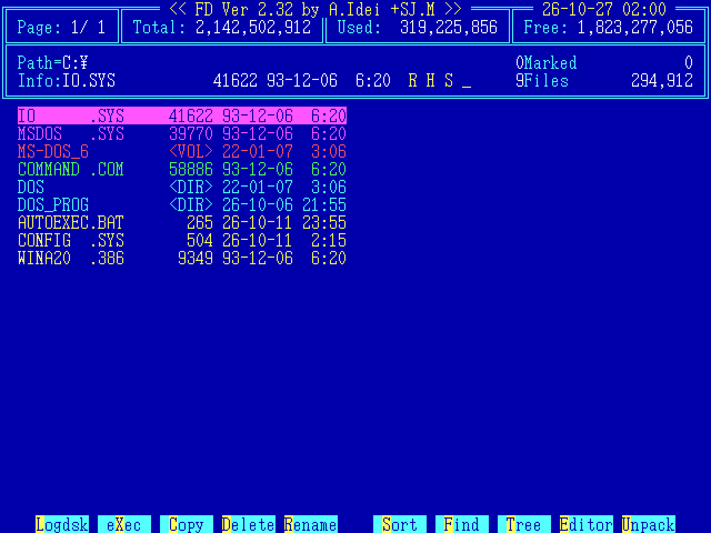
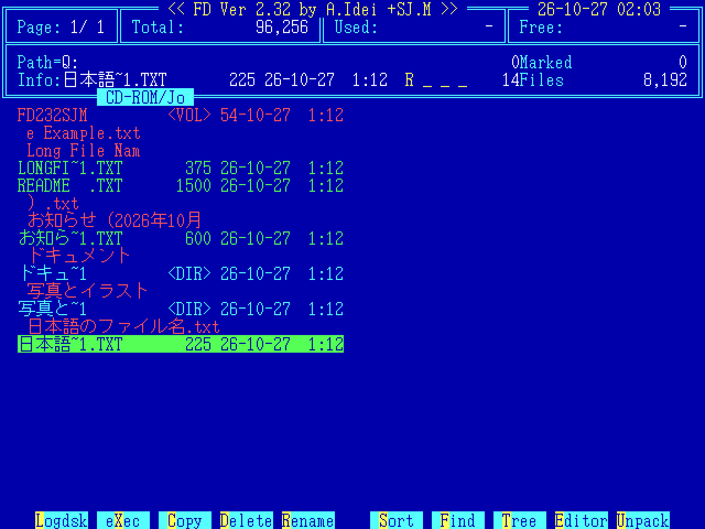
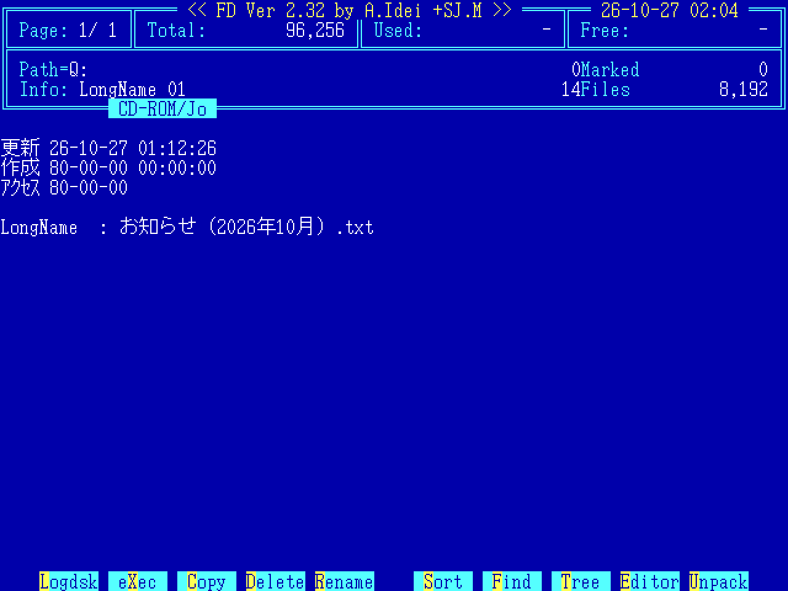
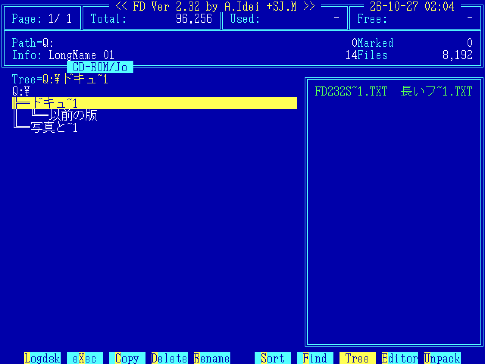
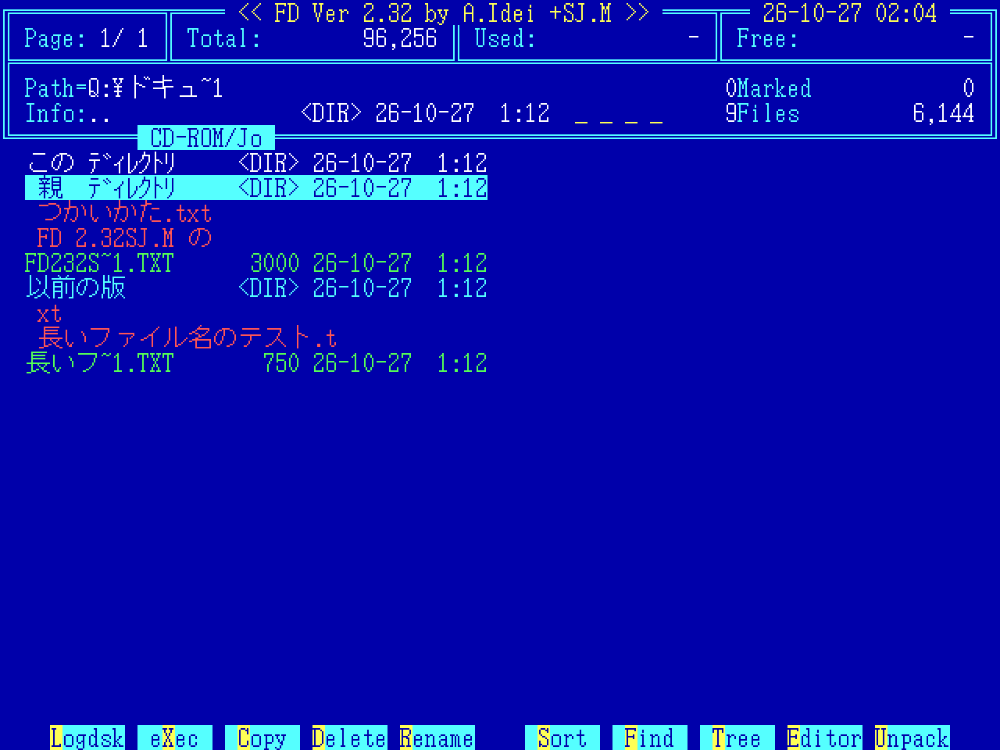

# FD 2.32SJ.M — FD98 2.32SJ の DOS/V 対応版

<p align="center">
  
</p>

PC-9801 用のファイル管理ツール **FD Ver.2.32**（A.Idei 氏）に、ARGON 氏の **FD30 Release 3.20** と「城」氏の **FD98 パッチ SJ** を当てた「FD98 2.32SJ」を、PC/AT 互換機の **日本語 DOS/V** で動くようにする差分です。

*A differential patch (BDIFF/BUPDATE) that makes the PC-9801 file manager FD 2.32 with the FD30 and SJ patches run on Japanese DOS/V (PC/AT compatibles). Documentation is in Japanese.*

## はじめに

FD は A.Idei 氏が作られたファイル管理ツールです。PC-9801 版の FD は Ver.2.32 のあと、ARGON 氏の「FD30」によって 30 行画面などに対応し、さらに「城」氏の「FD98 パッチ SJ」によって、長いファイル名、CD-ROM、ネットワークドライブ、Windows 95 などに対応する大きな拡張を受けて、長く使い続けられてきました。

DOS/V 用の FD としては Ver.3.13（FD55）がありますが、FD30 と SJ の機能を持った 2.32 系は PC-98 専用でした。この 2.32SJ.M は、その FD98 2.32SJ を日本語 DOS/V で使えるようにしたものです。

FD そのものはもちろん、FD30、SJ パッチの機能と使い勝手は、すべて三氏の長年の仕事によるものです。改変は DOS/V で動かすために必要な部分と、正しく動かすための最小限の不具合修正にとどめ、キーの対応や使えなくなる機能の扱いは、原作者 A.Idei 氏が Ver.3.12/3.13 で示された PC-98 版と DOS/V 版の違いに倣いました。

なお、これは純粋な SJ パッチではないため、名称を「SJ.M」としています。本差分について、三氏へのお問い合わせはご遠慮ください。

## 画面

### CD-ROM の長いファイル名（Joliet）

SJ パッチの機能により、CD-ROM を直接読んで、Joliet の日本語の長いファイル名を表示します（EMS が必要です）。

<p align="center">
  
</p>

長い名前は、互換名（`お知ら~1.TXT` など）の上の行に表示されます。名前が 2 行にまたがるときは、ディレクトリ・エントリの記録順のとおり後半が上に出ます（SJ 本来の表示です）。長い名前の行で `Enter` を押すと、名前全体を表示します。

<p align="center">
  
</p>

### Tree

FD30 の機能により、Tree の右側に選んだディレクトリのファイルを表示します。

<p align="center">
  
</p>

<p align="center">
  
</p>

画面はすべて VMware 上の MS-DOS 6.2/V（30 行モード、MS-DOS 標準のフォント）で、配布の FD.CFG（CD-ROM の画面のみ `ems40 = 1`）を使っています。CD の内容は表示見本として用意したものです。

## 内容

| ファイル | ブラウザで読む | 内容 |
|---|---|---|
| `FDPC_SJM.BDF` | | 差分（FD Ver.2.32 for PC-9801 のオリジナル → 2.32SJ.M） |
| `FDPC_SJM.DOC` | [UTF-8 版](utf8/FDPC_SJM.txt) | 説明書（インストール、使い方、PC-98 版との違い、制限事項） |
| `SJMUSAGE.DOC` | [UTF-8 版](utf8/SJMUSAGE.txt) | FD30、SJ の機能の使い方（DOS/V のキー名で） |
| `SJMTECH.DOC` | [UTF-8 版](utf8/SJMTECH.txt) | 技術リファレンス（FD の構成、機種による違い、パッチの方式） |

`.DOC` は DOS で読むための Shift_JIS（改行 CR+LF）で、配布物はこちらです。`utf8/` の `.txt` は同じ内容を UTF-8（改行 LF）にしたもので、GitHub 上でそのまま読めます。

差分と説明書をまとめた `FDPC_SJM.LZH`（DOS で展開できる LHA 形式）と `FDPC_SJM.ZIP`（中身は同じ）を Releases に置いています。

## 必要なもの

- 日本語 DOS/V（V-text 表示）。MS-DOS 6.2/V（25 行、30 行）と、Windows 95（日本語版 OSR2.1）の MS-DOS プロンプトで動作を確認しています
- 次のファイル（各自で入手してください）

| ファイル | 内容 |
|---|---|
| `FD98_232.LZH` | FD Ver.2.32 for PC-9801（オリジナル） |
| `BDIFF128.LZH` | BDIFF/BUPDATE 1.28（`BUPDATE.EXE` を使います） |

FD30、SJ の差分を先に当てる必要はありません（この差分に含まれています）。

## インストール

1. `FD98_232.LZH` から次の 4 ファイルを取り出します。

   ```
   FD       COM     1900  91-07-05   2:32
   FD98     COM    36212  91-07-05   2:32
   FDCUST2  COM     1754  91-07-05   2:32
   FD       CFG     5308  91-07-05   2:32
   ```

2. この 4 ファイル、`FDPC_SJM.BDF`、`BUPDATE.EXE` を同じディレクトリに置き、**DOS のコマンドラインで**（FD の中からではなく）実行します。

   ```
   C:\FD>BUPDATE FDPC_SJM
   ```

3. 次の大きさになれば完了です。

   ```
   FD       COM    40039
   FD98     COM    60187
   FDCUST2  COM     2527
   FD       CFG     7672
   ```

4. できた 4 ファイルを PATH の通ったディレクトリに置き、`FD` で起動します（FD98.COM は FD.COM から起動されるファイルで、単独では起動しません）。

差分を当てた直後（FDCUST2 を実行する前）のファイルの SHA-256 は次のとおりです。

```
FD.COM       7d60060b96756075f57e650aebaf6be6893e23044b1204cd4524d31f0f7d0e73
FD98.COM     4466e3a5355b61984a9050ee9c4a6f92f577230502840aaed9bd374738d8e168
FDCUST2.COM  51b5814525538125c8461107dea5b41c3b5112c1bae30a13fe9b1c7f775f68e5
FD.CFG       74dbdfbdc04f1eae349a02e7e6a1fcda0bb97adbab24d97b0759acf99a288e76
FDPC_SJM.BDF 99e783d0520f069d0d9b15c772afe1f3fbbde967224bc73fa6cde7998974a3c9
```

### うまくいかないとき

- BUPDATE はファイルの日付・長さ・チェックサムを照合します。アーカイブから取り出したままのファイルを使ってください。
- **FDCUST2 を一度でも実行した FD98.COM** や、**編集した FD.CFG** は、日付や長さが元のままでも中身が変わっているため当たりません。取り出し直してください。
- 途中で失敗した場合は、できかけのファイル（`FD.COM`、`*.ORG`、`*.000` など）を消して、4 ファイルを取り出し直してからやり直してください。

自分の FD.CFG を使う場合は、差分を当てた後に FD.CFG と置き換えて FDCUST2 を実行してください。PC-98 版で使っていた FD.CFG もそのまま使えます。SJ の追加項目（`pack2`、`n_pack`、`copy13`、`err24`）は配布の FD.CFG には含まれていないので、使う場合は SJ の説明書（FD98.TXT）を見て、FD.CFG の最後に書き足してください。

## キーの対応

FD.DOC（Ver.3.12/3.13）で原作者が示している IBM と PC-9801 のキーの対応に従っています。

| DOS/V | PC-9801 |
|---|---|
| `Alt` | `GRPH` |
| `Page Up` / `Page Down` | `ROLL DOWN` / `ROLL UP` |
| `Home` | `HOME CLR` |
| `End` | `SHIFT` + `HOME CLR` |
| `Enter` | `RET` |
| `F11` | `HELP` |
| `F1`～`F10` | `f･1`～`f･10` |
| `無変換` / `変換` | `NFER` / `XFER` |

ファンクションキーの割り当ては 2.32 のままです（`F1` が Logdsk のため、ヘルプは `F11`）。

## PC-98 版との主な違い

- PC-98 のディスク BIOS を直接使う機能（[B]ackup、フロッピーのボリュームラベル行での C/D/K）は、Ver.3.x の DOS/V 版と同様に使えません。
- 画面の行数は DOS/V の現在の行数に合わせます（25 行、30 行など）。
- 罫線や枠は DOS/V の半角罫線（二重線）で表示します。
- 色は PC-98 と同じく明るい色で表示します。アンダーラインは、その色の暗い背景に明るい文字で表示します。
- 外部コマンドの実行時と終了時に画面を消去します（Ver.3.x の DOS/V 版と同じ動作です）。
- SJ 自身の不具合を 1 件修正しています（CD-ROM の読み込みエラーで「もう一度」を選ぶと暴走する）。

詳しくは `FDPC_SJM.DOC` の「６．PC-98 版との違い」「７．制限事項」を参照してください。

## しくみ

FD98.COM の処理はほぼそのままで、PC-98 のテキスト画面・キーボード・コンソール（INT 18h、INT DCh、テキスト VRAM など）を DOS/V 上で模擬する部分を FD.COM に追加しています。FD98.COM の大きさや配置は変えていないので、FD.CFG と FDCUST2 によるカスタマイズは PC-98 版と同じです。詳しくは `SJMTECH.DOC` を参照してください。

## 制限事項（抜粋）

- 日本語 DOS/V（V-text 表示）が必要です。英語モード（CHEV US など）では使えません。
- DOSBox-X など、DOS の内部構造（CDS）を持たない DOS 環境では使えません（SJ と同じ制限です）。
- 長いファイル名の表示には EMS が必要です（`ems40 = 1` にして FDCUST2 を実行）。Windows 95 の MS-DOS プロンプトでは、VFAT の長いファイル名の表示・コピー・削除も確認しています。
- 次の環境では確認できていません：ネットワークドライブ、Windows 95 の MS-DOS モード、MS-DOS 6.2/V 以外の DOS/V、実機。

## 配布条件

- この差分（`FDPC_SJM.BDF`）とドキュメントの転載・配布は自由です。
- ただし「城」氏の SJ パッチの配布条件により、**差分を当てたあとの FD98.COM などをそのまま配布・転載しないでください。**
- オリジナルの作成者 A.Idei 氏、FD30 の作成者 ARGON 氏、SJ パッチの作成者「城」氏の配布条件も尊重してください。この差分には、SJ パッチに含まれる FD.COM の差分（FD_SJ.BDF）をそのまま含んでいます（SJ の配布条件で、差分の転載・配布は自由とされています）。
- この差分を使用したことによる損害等について、作成者は責任を負いません。また、A.Idei 氏、ARGON 氏、「城」氏はこの差分とは無関係です。

## 謝辞

| | |
|---|---|
| FD | A.Idei 氏 |
| FD30 | ARGON（T.Yajima）氏 |
| FD98 パッチ SJ | 「城」（"JOE"）氏 |
| BDIFF/BUPDATE | T.Tanaka 氏（TNT Technology） |

すばらしいソフトウェアを作り、公開してくださった各氏に、心から感謝します。

---

Kenji Morimoto — https://github.com/morimoto-kenji
